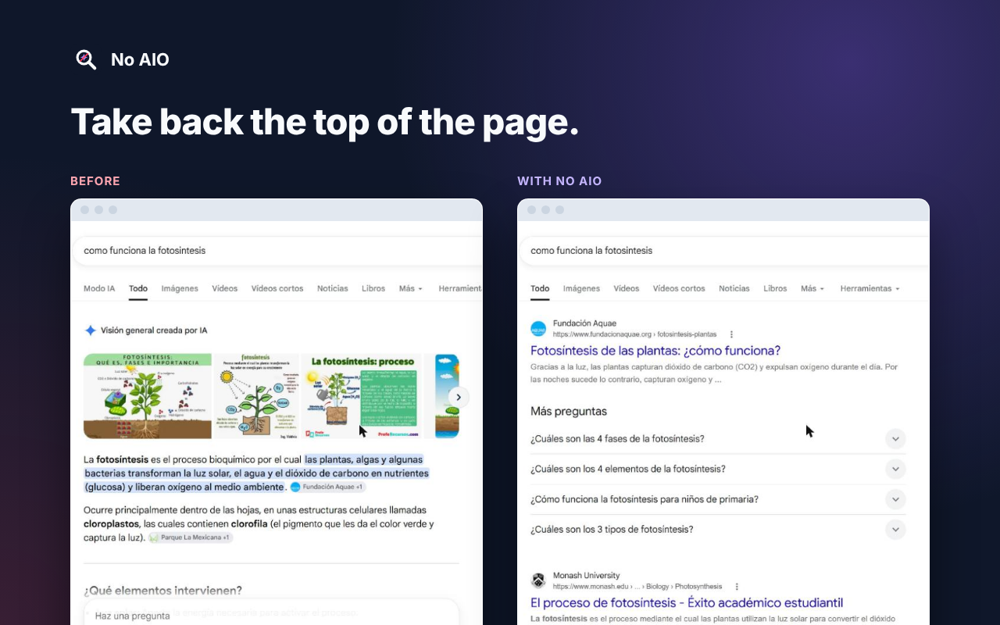

<p align="center">
  
</p>

<h1 align="center">No AIO</h1>
<p align="center"><b>Google search, minus the AI summary.</b><br/>Google, sin el resumen de IA.</p>

<p align="center">
  <a href="https://github.com/pablojarring/no-aio/actions/workflows/ci.yml"></a>
  <a href="LICENSE"></a>
  
  
</p>

<p align="center"></p>

Open-source Chrome extension that removes Google's **AI Overview** (*Visión general creada por IA*) and, optionally, the **AI Mode** tab from Google Search. Google offers no setting to turn AI Overviews off; this is that switch.

> 🇪🇸 Extensión open source que quita el resumen de IA de Google. Google no tiene una opción para desactivarlo, así que No AIO es ese interruptor. [Ver sección en español ↓](#español)

## Modes

| Mode | What it does | Trade-off |
|---|---|---|
| **Hide** (default) | Loads the normal "All" results and hides the AI block as it streams in | Keeps images, videos, "People also ask", side panel |
| **Web (udm=14)** | Opens every search in Google's own Web filter, so no AI summary is generated | Most robust, but plain links only. Off by default |

## Install

- **Chrome Web Store:** *coming soon*
- **From source:** `git clone`, then go to `chrome://extensions`, turn on **Developer mode**, click **Load unpacked** and select the folder.

## How it works

- `src/detector.js` finds headings whose exact text is an AI Overview title (10 languages, `AIO_LABELS`). It then climbs to the highest ancestor that does **not** contain the organic results (`#rso`, `#center_col`, `#rhs`). No reliance on Google's obfuscated class names.
- `src/content.js` runs at `document_start` with a `MutationObserver`, because the AI block streams in after the first paint.
- `rules/udm14.json` is a `declarativeNetRequest` ruleset. It adds `udm=14` only to searches without an existing filter, and the service worker enables it only in Web mode.
- `domains.txt` holds Google's 187 official domains ([source](https://www.google.com/supported_domains)), from which `manifest.json` is generated.

## Privacy

No data collected, no network requests, no remote code. See [PRIVACY.md](PRIVACY.md).

## Contributing

AI Overview titles in new languages and popup translations are the most useful contributions. See [CONTRIBUTING.md](CONTRIBUTING.md).

```bash
npm install && npm test
```

## Español

**Modos:** *Ocultar* deja la búsqueda normal y esconde solo el bloque de IA. *Web (udm=14)* abre siempre el filtro Web de Google, así que el resumen ni se genera.

**Si el resumen vuelve a aparecer:** Google cambió el título o el DOM. Abre un issue con la plantilla "El resumen de IA sigue apareciendo", o agrega el título exacto a `AIO_LABELS` en `src/detector.js` y manda un PR.

**Privacidad:** no recolecta nada. Ver [PRIVACY.md](PRIVACY.md).

---

Made by **Oniria** · MIT License · Not affiliated with or endorsed by Google. "Google" is a trademark of Google LLC.
